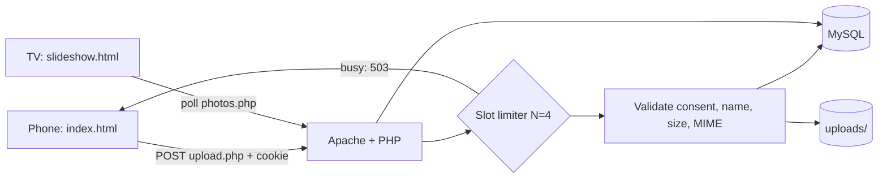

# Architecture
## Stack choices
| Layer | Choice | Why |
|---|---|---|
| Frontend | HTML/CSS/vanilla JS | Required stack; no build step; works on smart-TV browsers |
| Backend | PHP 8 + PDO | Required stack; prepared statements prevent SQL injection |
| DB | MySQL | Required; relational fit (visitor 1—N photos), FK cascade supports GDPR erasure |
| Queue | flock slot files + 503/Retry-After | No extra infrastructure |
| Updates | 2 s polling | Simple, resilient |
## Data model
```
visitors(id PK, token_hash UNIQUE, name, consent_at, consent_version, created_at)
photos(id PK, visitor_id FK -> visitors ON DELETE CASCADE, filename, created_at)
uploads/<random>.jpg|png   (PHP execution disabled via .htaccess)
```
## Diagram

## Security notes
Random filenames; no PHP execution in `uploads/`; prepared statements; names rendered with `textContent` (XSS-safe); `.env` git-ignored.
